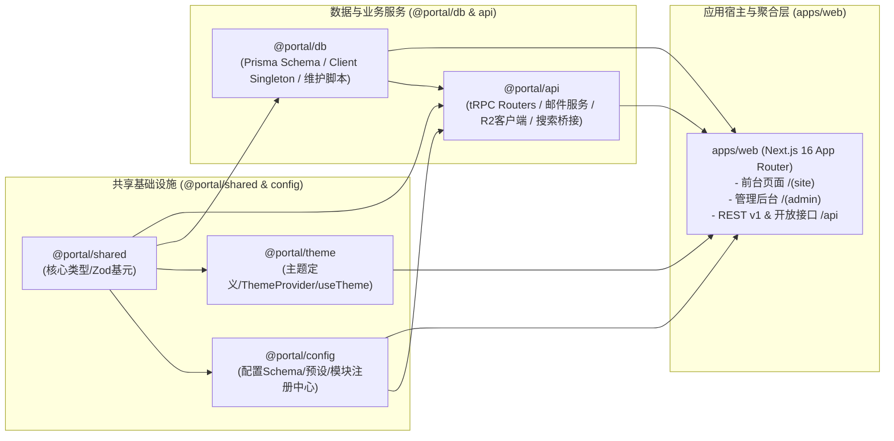

# Portal — 个人全栈门户架构设计规范 (v1.0)

> **版本**：v1.0.7（生产落地版本）  
> **更新时间**：2026-11-02  
> **基线状态**：基于当前生产工程实现深度核准并定稿，全面替代初期 RFC 方案草案。

---

## 1. 项目概述 (Project Overview)

**Portal** 是一个**高度模块化、主题可配置、双首页布局、深度集成 AI 与自动化能力**的现代个人全栈门户与内容管理平台。系统由全栈 TypeScript 核心驱动，辅以轻量 Python 微任务，深度整合了技术博客、多媒体作品集、图书阅读清单、每周 AI 开源趋势追踪、开发者实用工具箱以及全功能管理后台。

### 核心设计原则

1. **模块化与开箱即用 (Modular by Design)**：所有业务功能以独立模块形态存在，通过中央模块注册表与站点配置实现按需启停，导航菜单与页面路由动态同步。
2. **双引擎与视觉美学 (Dual Layout & Advanced Theming)**：原生内置 **经典流式 (Classic)** 与 **Metro Grid 网格 (Tessellate Noir)** 两套首页布局引擎，并在编译期通过 React Server Components (RSC) 纯服务端分发；内置 6 套精雕细琢的现代配色系统，基于原生 CSS 变量驱动。
3. **全栈类型安全 (End-to-End Type Safety)**：以 Next.js 16 App Router、tRPC v11 与 Prisma ORM 为核心骨架，从数据库 Schema、API 过程入参到前端 UI 组件实现 100% 端到端类型推导。
4. **开放接口与生态就绪 (REST API & LLM Readiness)**：不仅支持标准前台展示，还内置面向自动化发布流水线及 MCP (Model Context Protocol) Agent 的 **REST API v1** 规范接口；原生输出符合标准规范的 `/llms.txt` 与纯文本 Markdown 端点，对 LLM 抓取与 AI RAG 高度友好。
5. **高吞吐与容灾韧性 (Performance & Resilience)**：客户端打点内存批处理队列、数据生命周期滚动归档清理、全文搜索引擎无缝降级兜底、以及对象存储解耦，确保低运维负载与极致访问体验。

---

## 2. 系统整体架构 (System Architecture)

### 2.1 系统全局架构图

```mermaid
graph TB
    subgraph "客户端与外部生态 (Clients & Integrations)"
        CLI_WEB["🖥️ 桌面/移动浏览器 (Next.js SSR/RSC)"]
        CLI_LLM["🤖 LLM 爬虫 / AI Agents (/llms.txt)"]
        CLI_MCP["⚡ MCP Server / 自动化发布脚本"]
        CLI_CRON["⏰ 系统 Crontab / 定时器"]
    end

    subgraph "前端展示与交互层 (apps/web)"
        THEME["🎨 主题引擎 (6套预设主题 / CSS变量)"]
        LAYOUT_DISPATCH["📐 布局分发器 (Classic vs Metro Grid)"]
        I18N_ROUTER["🌐 国际化路由 (next-intl /[locale])"]
        TOC_ENGINE["📑 TOC 目录引擎 (IntersectionObserver)"]
        TRACK_QUEUE["⚡ 分析打点队列 (5条/5s批处理 + keepalive)"]
    end

    subgraph "API 路由与开放网关层 (API Gateway)"
        AUTH_GATEWAY["🔐 NextAuth v5 (GitHub OAuth / Credentials JWT)"]
        TRPC_SERVER["🚀 tRPC v11 过程路由 (16个业务 Routers)"]
        REST_V1["🔌 REST API v1 (/api/v1/posts, categories, upload)"]
        REST_BRIDGE["🔗 API Key 鉴权桥接器 (x-api-key -> Admin Context)"]
        RSS_ENGINE["📡 RSS / Atom 订阅引擎 (/api/feed.xml)"]
        RAW_MD["📝 Raw Markdown 导出端点 (/api/raw/blog)"]
        LLM_ENDPOINTS["📄 LLM 索引端点 (/llms.txt, /llms-full.txt)"]
        TOOLS_PROXY["🛡️ HTTP Client CORS 代理 (/api/tools/proxy)"]
    end

    subgraph "业务服务与领域模型 (packages/api & services)"
        SVC_POST["博客与分类管理"]
        SVC_BOOK["图书阅读与翻译版本管理"]
        SVC_TREND["AI Trending 趋势汇总"]
        SVC_PORTFOLIO["作品集与法务条款"]
        SVC_COMMENT["评论审核与嵌套回复"]
        SVC_LINK["友链申请与健康检测"]
        SVC_ATTACH["附件管理 (Cloudflare R2 直连)"]
        SVC_EMAIL["可插拔邮件通知服务 (Mailgun / SendGrid)"]
        SVC_SEARCH["双模全站搜索服务 (MeiliSearch + DB ILIKE 容灾)"]
        SVC_ANALYTICS["分析统计与 90 天归档清理"]
    end

    subgraph "数据与存储基础设施层 (Infrastructure Layer)"
        DB_PG[("🐘 PostgreSQL 16 (Prisma ORM, 21张表)")]
        STORE_R2[("☁️ Cloudflare R2 对象存储 (S3 兼容)")]
        SEARCH_MEILI[("⚡ MeiliSearch 全文搜索引擎")]
        CACHE_REDIS[("🔴 Redis 7 (缓存与辅助队列)")]
    end

    subgraph "独立微任务层 (schedule/)"
        PY_TREND["🐍 Python Trending Cron Worker\n(GitHub API + LLM 双语摘要生成)"]
    end

    %% 连接关系
    CLI_WEB --> I18N_ROUTER
    CLI_LLM --> LLM_ENDPOINTS & RAW_MD
    CLI_MCP --> REST_V1
    CLI_CRON --> PY_TREND

    I18N_ROUTER --> LAYOUT_DISPATCH
    LAYOUT_DISPATCH --> THEME & TOC_ENGINE
    TRACK_QUEUE --> TRPC_SERVER

    REST_V1 --> REST_BRIDGE --> TRPC_SERVER
    I18N_ROUTER --> TRPC_SERVER & AUTH_GATEWAY & RSS_ENGINE & TOOLS_PROXY

    TRPC_SERVER --> SVC_POST & SVC_BOOK & SVC_TREND & SVC_PORTFOLIO & SVC_COMMENT & SVC_LINK & SVC_ATTACH & SVC_EMAIL & SVC_SEARCH & SVC_ANALYTICS

    SVC_POST & SVC_BOOK & SVC_PORTFOLIO & SVC_COMMENT & SVC_LINK & SVC_ANALYTICS --> DB_PG
    SVC_ATTACH --> STORE_R2
    SVC_SEARCH --> SEARCH_MEILI
    SVC_SEARCH -.->|降级容灾| DB_PG
    PY_TREND -->|直接入库| DB_PG
```



### 2.2 核心模块依赖拓扑



---

## 3. 功能模块详细设计 (Functional Modules)

### 3.1 核心基石模块（系统强制启用）

| 模块 | 核心职责与关键实现 | 支撑技术 |
| :--- | :--- | :--- |
| **主题引擎** | 提供 6 套精心调校的现代预设主题；基于 CSS 变量与 Tailwind CSS v4 `@theme` 桥接；支持系统深浅色偏好与用户手动覆写；具备服务端抗闪烁脚本 (Anti-FOUC)。 | `@portal/theme`, Tailwind v4, LocalStorage |
| **双首页布局引擎** | 支持 `classic`（经典流式）与 `metro`（Tessellate Noir 12 栏高反差网格）两套完全不同的首页视觉体验；纯 React Server Component 服务端分发，零客户端水合负担，零布局抖动 (CLS = 0)。 | `ClassicLayout`, `MetroLayout`, `site.config.ts` |
| **动态路由与模块中心** | 中央模块注册中心统一维护路由与导航项；根据 `siteConfig.modules[id].enabled` 动态注册与剔除前台菜单与后台路由。 | `@portal/config/moduleRegistry`, `next-intl` |
| **国际化 (i18n)** | 全面基于 `next-intl` 4.x，支持中英文（`zh-CN` / `en-US`）；统一采用 `/[locale]/...` 路由体系，具备智能 `as-needed` 语言前缀判定与页面级双语元数据生成 (`getAlternates`)。 | `next-intl`, Messages JSON |
| **统一身份认证与授权** | 基于 NextAuth v5 (Auth.js beta)；支持 GitHub OAuth 社交登录与邮箱密码凭证登录（bcryptjs 哈希）；内置 RBAC 三级权限（`admin`, `editor`, `viewer`）；tRPC 内置 `protectedProcedure` 与 `adminProcedure` 严格守卫。 | `@auth/prisma-adapter`, NextAuth v5, bcryptjs |
| **SEO 与 LLM 规范引擎** | 自动生成动态 `sitemap.xml` 与 `robots.txt`；自动组装 OpenGraph / Twitter Card 社交标签；全自动注入 Schema.org (`WebSite`, `Article`) 结构化数据；原生输出 `/llms.txt` 与 `/llms-full.txt` 规范端点。 | Next.js Metadata API, Schema.org |

---

### 3.2 业务功能模块矩阵

#### 1. 📝 博客系统 (Blog)
- **内容排版**：采用 `next-mdx-remote` + `remark-gfm` + `remark-math` (KaTeX) + `rehype-slug`，原生支持 GFM 语法、数学公式、代码高亮（`lowlight`/`highlight.js`）及 `mermaid` 图表渲染。
- **文章自动目录 (TOC)**：
  - 基于文章中 `<h2>` 标题自动提取，在桌面端右侧以 Sticky 侧边栏呈现。
  - 核心采用浏览器原生 `IntersectionObserver` 监听标题入屏状态，页面滚动时 JS 线程 CPU 占用率为 0%，告别高开销的 `onscroll` 轮询。
  - 平滑锚点跳转，自动抵扣顶部固定 Header 的安全偏置高度。
- **多语言与分类**：支持中英文双语分类映射（`Category.name_en`）及标签检索。
- **阅读量统计**：文章阅读数在 `Post.views` 中完成独立持久化与原子自增。
- **开放导出**：
  - `/api/feed.xml`：标准的 RSS 2.0 / Atom 订阅源。
  - `/api/raw/blog/[slug]`：提供携带标准 YAML Frontmatter 的干净 Markdown 原文，专供 AI Agent 与 CLI 读取。

#### 2. 📚 图书阅读与书评系统 (Books)
- **书单与元数据**：维护书籍封面、书名、作者、译者、出版社、ISBN、出版年份及推荐评语。
- **电子书阅读集成**：支持直达阅读链接（`ebookUrl`），方便读者快速跳转至在线电子书资源。
- **原著与译本自关联**：基于 Prisma 自关联设计（`originalBook` $\leftrightarrow$ `translations`），精准关联同一部作品的不同语言版本。
- **互动评价**：已登录用户可进行点赞（`LIKE`）或踩（`DISLIKE`），系统实时聚合热度指标。

#### 3. 🔥 AI 趋势榜单 (AI Trending)
- **GitHub 热门项目抓取**：针对 AI / LLM 领域，通过独立 Python 定时微任务（[`schedule/fetch_trending.py`](file:///Users/rick/src/portal/schedule/fetch_trending.py)）每周一批量抓取 GitHub 热门开源仓库。
- **Star 增速演算**：自动计算相较于上周的历史 Star 净增量（`starsGrowth`），反映开源技术真实热度。
- **双语 AI 摘要生成**：自动调用大模型（OpenAI / DeepSeek 等）对仓库 README 与描述进行总结，生成结构化的高质量中英文双语摘要（`summaryZh` / `summaryEn`）。
- **周度历史归档**：以每周周一的日期为时间戳（`weekOf`）进行快照沉淀，前台支持按周筛选回溯。

#### 4. 🎨 作品集系统 (Portfolio)
- **多维度展示**：项目卡片、高清封面、演示地址（`liveUrl`）、源码仓库（`repoUrl`）、技术栈标签、精选标记（`featured`）。
- **法务条款子页面集成**：针对独立软件与 SaaS 产品，内置专用的法务条款路由 `/[locale]/portfolio/[slug]/[docType]`，支持在后台直接维护中英文《隐私政策》(Privacy Policy) 与《服务条款》(Terms of Service)。
- **多端资产下载**：在 `downloadLinks` 字段中存储结构化 JSON，支持多平台客户端（macOS、Windows、Linux、iOS、Android）一键下载分发。

#### 5. 🛠️ 开发者实用工具箱 (Tools)
精选 6 款完全免于外部依赖或经安全代理处理的高效 Web 工具：
1. **Base64 编解码器 (`/tools/base64`)**：文本与 Base64 互相转换。
2. **JSON 格式化校验器 (`/tools/json-formatter`)**：格式化、压缩、排错及语法高亮。
3. **JWT 解码验证器 (`/tools/jwt-decoder`)**：纯客户端解析 Header 与 Payload，展示过期时间与签发细节。
4. **二维码生成器 (`/tools/qrcode`)**：自定义色彩、容错等级，支持中心嵌入 Logo。
5. **HTTP Client API 测试工具 (`/tools/http-client`)**：
   - 极简版 Postman，支持 `GET/POST/PUT/DELETE` 等全方法、Headers、Body 与 Params 配置。
   - 解决纯浏览器端调用第三方接口的跨域限制：提供内置服务端代理接口 `/api/tools/proxy`。
   - 一键生成并复制 cURL 与 JavaScript `fetch()` 调用代码。
6. **Markdown 实时编辑器 (`/tools/markdown-editor`)**：双栏左右分屏同步滚动预览，支持导出 HTML/MD。

#### 6. 🔗 友情链接 (Links)
- **前台提交与审核流**：访客可自主提交友链申请，初始状态为 `pending`，经管理员审批后公开上线。
- **防刷与限流**：记录申请人 IP（`submitterIp`），实施频率限制。
- **智能头像解析**：无缝对接全局头像引擎（WeAvatar / Cravatar），自动抓取申请网站 Favicon 或作者头像。
- **存活探测与健康检查**：后台提供存活探测能力（`isAlive` 标识）。
- **邮件通知闭环**：申请审批通过后，自动向申请人邮箱发送祝贺通知邮件。

#### 7. 💬 评论与留言板 (Comments & Guestbook)
- **树状多级嵌套**：基于 `Comment.parentId` 实现无限层级回复与嵌套渲染。
- **审核与防垃圾**：支持审核开关（`siteConfig.comments.requireModeration`）；三态流转（`pending` $\rightarrow$ `approved` / `spam`）。
- **自动化邮件触发**：
  - 访客评论审核通过 $\rightarrow$ 触发通知邮件。
  - 评论收到他人回复 $\rightarrow$ 自动通知被回复人。
  - 文章发表新评论 $\rightarrow$ 自动通知博主/管理员。

#### 8. 🔍 双模容灾全站搜索 (Search)
- **高性能 MeiliSearch 检索**：针对 Post 文章建立全文索引，支持打字即搜、高亮标记（`attributesToHighlight`）。
- **无缝降级容灾设计**：当 MeiliSearch 服务离线或出现异常时，自动平滑降级至 PostgreSQL `ILIKE`（`mode: 'insensitive'`）模糊匹配，保证前台搜索永远可用。
- **跨实体并行联合搜索**：单次搜索请求在检索文章的同时，并行跨库检索图书（Book）与作品集（Project），输出统一的搜索结果聚合卡片。

#### 9. 📊 访问统计与数据归档 (Analytics)
- **客户端内存事件队列 (`eventQueue`)**：
  - 页面跳转时不直接发起单个 HTTP 请求，而是推入内存队列。
  - 达到 5 个事件或闲置超过 5 秒触发批量上报。
  - 使用 `keepalive: true` 与 `visibilitychange` 监听器，确保关闭或切换标签页时事件不丢失。
- **后端批量入库**：采用 Prisma `createMany` 执行单条 SQL Bulk Insert，数据库写入开销降低 80% 以上。
- **数据生命周期与历史基线归档**：
  - 针对历史访问数据提供 90 天安全滚动清理脚本（`pnpm db:prune-analytics`）。
  - 执行物理删除前，在 `SiteConfig.archived_page_views` 中累加持久化全站总 PV 与核心页面（`/`, `/blog`, `/links` 等）的历史累计基线，保证展示数据永不断崖丢失。
  - 自动剥离 `/[locale]` 国际化前缀，实现路径的统一归一化统计。

#### 10. 📑 代码/组件沙箱引用 (References) 与 📦 附件管理 (Attachments)
- **Reference 沙箱**：存储独立的 HTML 代码，通过 `/references/[slug]` 以纯净 `text/html` 提供访问，隔离主站样式与脚本。
- **R2 附件管理**：完全基于 Cloudflare R2（S3 兼容协议），通过 `@aws-sdk/client-s3` 进行文件的直传与生命周期销毁，彻底从 PostgreSQL 中移除大文件二进制存储（BLOB）。

---

## 4. 主题系统设计 (Theme System)

### 4.1 生产环境 6 套预设主题

| 主题标识 (ID) | 中文名称 | 风格基调 | 核心视觉特征 | 适用场景 |
| :--- | :--- | :--- | :--- | :--- |
| **`zenith`** *(默认)* | 苍穹原野 (Zenith Ethereal) | 浅色 / 自然高雅 | 鼠尾草绿 (`#536746`)、暖陶土色 (`#755754`)、柔和米白底 (`#efefef`)，大圆角与环境柔和阴影 | 现代高品质个人主页、随笔写作 |
| **`lumiere`** | 卢米埃尔 (Lumiere Editorial) | 浅色 / 杂志排版 | 经典焦橙 (`#e85d04`)、深炭灰文字 (`#1b1b1b`)、羊皮纸色底 (`#faf8f5`)、衬线标题与 0px 硬朗硬角 | 摄影师、深度长文博主、设计师 |
| **`dark-neon`** | 极客霓虹 (Dark Neon) | 深色 / 科技未来 | 靛蓝 (`#6366f1`)、紫罗兰 (`#8b5cf6`)、青绿点缀 (`#22d3ee`)、深邃藏青底 (`#0f1117`) | 极客开发者、全栈工程师 |
| **`cyberpunk`** | 赛博朋克 (Cyberpunk) | 深色 / 高饱和波普 | 霓虹荧光粉 (`#ff2a6d`)、赛博青 (`#05d9e8`)、纯夜黑底 (`#0d0221`)、发光 Glow 阴影与等宽字体 | 前沿黑客、硬核技术工具展示 |
| **`retro-brown`** | 复古羊皮 (Retro Brown) | 浅色 / 怀旧书卷 | 暖棕色 (`#5c4033`)、复古金 (`#8b6914`)、暖牛皮纸底 (`#f5f0e8`)、Merriweather 经典衬线体 | 人文历史博主、书评笔记 |
| **`minimal-light`** | 极简透白 (Clean Portal) | 浅色 / 极简纯净 | 雅致雾霾蓝 (`#6b8ec9`)、冷灰底色 (`#f8f9fb`)、纯白卡片与高对比度排版 | 求职简历、极简技术备忘 |

### 4.2 主题接口契约 (`@portal/shared`)

```typescript
export interface ThemeConfig {
  id: string;
  name: string;
  mode: 'light' | 'dark';
  colors: {
    primary: string;
    secondary: string;
    accent: string;
    background: string;
    surface: string;
    surfaceAlt?: string;     // 嵌套次级区域底色
    text: string;
    textSecondary: string;
    textTertiary?: string;   // 辅助说明与标签色
    border: string;
    error: string;
    success: string;
  };
  typography: {
    fontFamily: string;
    headingFont: string;
    monoFont: string;
    scale: number;
  };
  spacing: {
    unit: number;
    radius: string;
  };
  effects: {
    shadow: string;
    blur: string;
    transition: string;
  };
}
```

---

## 5. 配置系统设计 (Configuration System)

### 5.1 五大预设组合 (Presets)

站点通过 `site.config.ts` 中的 `preset` 字段可一键装配对应的功能模块与默认主题：

| 预设组合 | 自动启用模块 | 推荐默认主题 | 适用业务场景 |
| :--- | :--- | :--- | :--- |
| **`minimal`** | About, Links | `zenith` | 极简个人名片、联系方式页 |
| **`tech-blog`** | Blog, About, Search, Analytics, Links | `zenith` | 纯技术博主、知识库分享 |
| **`creative`** | Portfolio, Gallery, About, Guestbook | `dark-neon` | 独立创作者、摄影师、设计师作品展 |
| **`devtools`** | Tools, Blog, Search, Analytics | `dark-neon` | 开发者实用工具站、技术资源分享 |
| **`full`** *(全功能)* | **全部模块**（含 Books、AI Trending 等） | `zenith` | 全功能一体化个人旗舰站 |

### 5.2 生产级配置实例范式

```typescript
// apps/web/src/site.config.ts
import { defaultAboutConfig, defineConfig } from '@portal/config';

export default defineConfig({
  site: {
    title: 'Voocii',
    description: 'A modular personal website platform',
    url: 'https://voocii.com',
    locale: 'zh-CN',
    author: 'Rick',
  },
  preset: 'full',
  theme: {
    default: 'zenith',
    available: ['zenith', 'lumiere', 'dark-neon', 'cyberpunk', 'retro-brown', 'minimal-light'],
    allowUserSwitch: true,
  },
  // 首页布局引擎选择: 'classic' (流式经典) 或 'metro' (Tessellate Noir 网格)
  homeLayout: 'classic',
  comments: {
    requireModeration: false, // 评论是否必须经人工审核后公开
  },
  // 头像代理与占位符模板
  avatar: {
    urlTemplate: 'https://weavatar.com/avatar/{hash}?d=initials&name={name}',
  },
  // 事务型邮件通知服务
  email: {
    enabled: true,
    provider: 'mailgun', // 'mailgun' | 'sendgrid' | 'smtp' | 'resend'
  },
  // 关于我结构化信息
  about: defaultAboutConfig,
});
```

---

## 6. 管理后台系统架构 (Admin Architecture)

管理后台通过 NextAuth 会话保护，仅允许 `role = 'admin'` 的用户进入，目前落地为 **14 个高度模块化的功能页面与 tRPC 子路由**：

```
apps/web/src/app/[locale]/(admin)/admin/
├── page.tsx                 # 仪表盘：实时 PV/UV、全站总览指标、最新审核队列
├── posts/                   # 文章管理：状态过滤、分页、批量删除
│   ├── new/page.tsx         # 新建文章（带 Markdown 即时预览与标签选择）
│   └── [id]/page.tsx        # 编辑文章
├── categories/page.tsx      # 分类管理：中英文分类名称与 Slug 维护
├── comments/page.tsx        # 评论管理：状态审批（Pending/Approved/Spam）、回复与邮件重发
├── guestbook/page.tsx       # 留言板管理：访客留言内容审核与删除
├── links/page.tsx           # 友链管理：前台申请审核、健康检测（Alive）、邮件通知
├── portfolio/               # 作品集管理：精选状态、下载链接维护
│   ├── new/page.tsx         # 新增作品及双语法务条款（Privacy/Terms）编辑
│   └── [id]/page.tsx        # 编辑作品
├── books/                   # 图书管理：原著与译本版本关联维护
│   ├── new/page.tsx         # 新建书单条目
│   └── [id]/page.tsx        # 编辑书单条目与推荐评语
├── trending/page.tsx        # AI Trending 管理：查看每周仓库、微调双语 AI 摘要
├── attachments/page.tsx     # 附件管理：Cloudflare R2 文件直传、删除与 CDN 外链获取
├── references/page.tsx      # 代码引用管理：独立 HTML 沙箱页面维护
├── about/page.tsx           # 关于我管理：职业经历时间线、社交链接及双语简介编辑
├── analytics/page.tsx       # 数据统计：趋势折线图、路径热度排行、90 天数据滚动清理执行
└── settings/page.tsx        # 系统设置：网站基本信息、全局主题、头像源及邮件配置查看
```

---

## 7. 开放接口与外部系统集成 (Open APIs & Integrations)

### 7.1 REST API v1 规范 (`/api/v1`)

专为 MCP (Model Context Protocol) 插件、CLI 脚本及 CI/CD 自动发布设计，具备独立的 API Key 认证机制。

- **认证方式**：
  - Header: `x-api-key: <ADMIN_API_KEY>`
  - Header: `Authorization: Bearer <ADMIN_API_KEY>`
- **统一桥接设计 (`api-auth.ts`)**：
  REST 路由收到请求并验证 API Key 后，通过 `createCallerFactory` 动态合成具备 Admin 身份的内部 tRPC 调用器，完全消除双重业务逻辑与校验冗余。
- **核心开放端点**：
  - `GET /api/v1/posts`：获取文章列表（提供 Key 可查看 Draft 草稿）。
  - `POST /api/v1/posts`：自动化创建文章并自动绑定标签与分类。
  - `GET /api/v1/posts/:id` / `PUT /api/v1/posts/:id` / `DELETE /api/v1/posts/:id`。
  - `GET /api/v1/categories` & `POST /api/v1/categories`。
  - `POST /api/v1/upload`：自动化文件与媒体直传。

### 7.2 可插拔邮件通知服务 (Email Service)

- **架构设计**：定义标准 `EmailProvider` 接口，解耦具体通道实现。
- **Provider 实现**：
  - `MailgunEmailProvider`：使用原生的 `fetch` 结合 Basic Auth 调用 Mailgun v3 REST 接口。
  - `SendgridEmailProvider`：使用原生 `fetch` 结合 Bearer Token 调用 SendGrid v3 邮件分发接口。
  - `NullEmailProvider`：当配置未启用或缺少密钥时平滑空转，不阻塞业务流程。
- **自动化业务触发点**：
  1. 友链审核通过时发送申请通知信（支持中英双语模版）。
  2. 访客评论审核通过时发送上线通知信。
  3. 评论被其他访客回复时，向原作者发送提醒信（含文章锚点直达）。
  4. 文章收到全新评论时，向管理员邮箱发送审核提醒。

### 7.3 多源头像服务 (Avatar Service)

支持灵活的占位符模式，统一处理前台访客、评论者及友链申请者的头像获取：
- **占位符**：`{hash}`（邮箱 MD5 小写）、`{name}`（URL 编码昵称）、`{email}`、`{size}`、`{fallback}`。
- **内置预设**：WeAvatar（微信/QQ 头像直连）、Cravatar（国内高速）、Gravatar（国际标准）、DiceBear（个性化矢量生成）、Robohash（机器人生成）。

### 7.4 Cloudflare R2 对象存储集成

- **架构收益**：通过 `@aws-sdk/client-s3` 将图片与大文件从数据库的 `Bytes` 字段中彻底解耦，降低数据库体积 90% 以上，并享受 Cloudflare 零出站流量费（Zero Egress Fees）的高速全球 CDN 分发。
- **存储操作**：封装 `uploadToR2` 与 `deleteFromR2`，自动处理文件名哈希冲突与 MIME 类型分配。

### 7.5 LLM 与 AI 生态端点 (LLM Readiness)

- **`/llms.txt`**：按照 AI Agent 索引规范，输出站点的核心结构、项目摘要、核心文章列表及清洁 Markdown 链接。
- **`/llms-full.txt`**：聚合站内全量文章、书评、关于我的结构化知识库，供大模型单次读取做上下文感知与 RAG 向量化。
- **`/api/raw/blog/[slug]`**：单篇文章的纯文本 Markdown 获取，去除任何 HTML 噪音与客户端包装。

---

## 8. 技术栈与生产依赖矩阵 (Tech Stack Matrix)

| 层次 | 核心技术选型 | 当前生产版本 | 选型关键考量 |
| :--- | :--- | :--- | :--- |
| **Monorepo** | Turborepo + pnpm | Turbo 2.8.7 / pnpm 9.15.4 | 极速全量构建与精准缓存，多包协同开发 |
| **应用框架** | Next.js App Router | **Next.js 16.1.6** (Turbopack) | React Server Components (RSC) 原生支持，服务端并发渲染与极致首屏体验 |
| **前端运行时** | React | **React 19.2.3** | 现代 Actions、并发更新机制与 Server Components |
| **样式引擎** | Tailwind CSS | **Tailwind CSS v4** | 原生 CSS 变量支持，免编译配置，极致打包速度 |
| **API 通信** | tRPC | **tRPC v11.10.0** | 前后端端到端类型安全，无需维护 Swagger 与客户端 SDK |
| **数据持久化** | Prisma ORM | **Prisma 6.x** | 声明式 Schema 即文档，强类型查询构建，完善的迁移工具链 |
| **主数据库** | PostgreSQL | PostgreSQL 16 (Alpine) | 强大可靠的 ACID 关系型数据库，具备原生 JSON 与全文索引能力 |
| **全文检索** | MeiliSearch | MeiliSearch Latest | 毫秒级即时搜索、排错容错与中英文分词能力 |
| **对象存储** | Cloudflare R2 | S3 Compatible (`@aws-sdk`) | 全球低延迟 CDN 加速，零出站流量费用 |
| **身份认证** | Auth.js (NextAuth) | **NextAuth 5.0.0-beta.30** | 与 Next.js App Router 深度绑定的无状态 JWT 会话体系 |
| **国际化** | next-intl | **next-intl 4.8.3** | 服务端组件友好的多语言解决方案，零运行时客户端包体开销 |
| **独立微任务** | Python 脚本 | Python 3.11+ | 针对 GitHub API 抓取与大模型批量交互的轻量级定时 Worker |
| **代码规范** | Biome | **Biome 2.3.15** | 替换传统 ESLint + Prettier，单工具链提供超高速格式化与代码检查 |
| **单元测试** | Vitest | **Vitest 4.0.18** | 原生 ESM 支持，与 Vite/Turbo 生态无缝配合的高速单元测试引擎 |

---

## 9. 拓扑结构与工程组织 (Project Directory Structure)

```
portal/
├── apps/
│   └── web/                                # Next.js 全栈主应用程序
│       ├── messages/                       # 多语言字典文件 (zh.json, en.json)
│       ├── public/                         # 静态资源 (Logo, Robots, BingSiteAuth)
│       ├── scripts/                        # 构建清理与 Sourcemap 处理脚本
│       └── src/
│           ├── app/
│           │   ├── [locale]/
│           │   │   ├── (admin)/admin/      # 14 个管理后台页面路由
│           │   │   ├── (site)/             # 12 个前台公开页面 (含双首页布局分发)
│           │   │   └── auth/signin/        # 统一登录认证页面
│           │   ├── api/
│           │   │   ├── auth/[...nextauth]/ # NextAuth 处理端点
│           │   │   ├── feed.xml/           # RSS 2.0 订阅输出
│           │   │   ├── raw/blog/[slug]/    # 纯文本 Markdown 导出
│           │   │   ├── tools/proxy/        # HTTP 客户端跨域安全代理
│           │   │   ├── trpc/[...trpc]/     # tRPC 统一接入端点
│           │   │   └── v1/                 # REST API v1 开放接口
│           │   ├── llms.txt/ & llms-full.txt/ # AI 生态索引端点
│           │   ├── references/[slug]/      # 独立 HTML 沙箱页面展示
│           │   └── uploads/[filename]/     # 静态附件直达中继
│           ├── components/                 # 前端 UI 与业务组件 (Home, Blog, Admin)
│           ├── i18n/                       # next-intl 路由与导航封装
│           ├── lib/                        # API Key 鉴权桥接、SEO 生成、tRPC 客户端
│           └── site.config.ts              # 站点核心全局配置文件
├── packages/
│   ├── api/                                # tRPC API 业务逻辑包
│   │   └── src/
│   │       ├── routers/                    # 16 个业务路由模块 (admin, post, book...)
│   │       ├── services/email/             # 可插拔邮件服务 (Mailgun, SendGrid)
│   │       ├── utils/r2.ts                 # Cloudflare R2 对象存储工具
│   │       ├── search.ts                   # MeiliSearch 全文索引同步器
│   │       └── trpc.ts                     # tRPC 上下文、中间件与 Procedure 守卫
│   ├── config/                             # 站点配置与预设包
│   │   └── src/                            # Zod Schema, 5 套预设, 中央模块注册表
│   ├── db/                                 # 数据库操作包
│   │   ├── prisma/                         # Schema 架构定义与数据库种子脚本
│   │   └── scripts/prune-analytics.ts      # 访问日志 90 天安全滚动清理归档脚本
│   ├── shared/                             # 前后端共享类型库 (Types & Utils)
│   └── theme/                              # 运行时主题引擎包 (6 套预设与 Provider)
├── schedule/                               # 独立 Python 定时微任务目录
│   ├── fetch_trending.py                   # GitHub AI 趋势爬取与 LLM 摘要生成
│   ├── requirements.txt                    # Python 依赖清单
│   └── run.sh                              # 自动化虚拟环境管理与执行脚本
├── documents/                              # 架构与开发文档集
├── docker-compose.yml                      # 本地基础设施容器编排 (PG, Redis, Meili)
├── turbo.json                              # Turborepo 任务编排配置
└── package.json                            # 根目录配置与自动化脚本
```

---

## 10. 完整数据模型设计 (Database Schema & ER)

系统当前由 **21 个核心数据模型** 组成，全面支撑认证、博客、图书、AI 趋势、作品集、互动及配置体系。

### 10.1 实体关系图 (Entity Relationship Diagram)

```mermaid
erDiagram
    %% Auth & User
    User ||--o{ Account : "has"
    User ||--o{ Session : "has"
    User ||--o{ Post : "authors"
    User ||--o{ BookLike : "evaluates"

    %% Blog & Content
    Post ||--o{ Comment : "receives"
    Post ||--o{ PostTag : "categorized by"
    Category ||--o{ Post : "groups"
    Tag ||--o{ PostTag : "applies to"
    Comment ||--o{ Comment : "replies to"

    %% Books
    Book ||--o{ BookLike : "liked by"
    Book ||--o{ Book : "translates (originalBookId)"

    %% Data Models Definition
    User {
        string id PK
        string email UK
        string name
        string role
        boolean receiveNotifications
        datetime createdAt
    }
    Account {
        string id PK
        string userId FK
        string provider
        string providerAccountId
    }
    Session {
        string id PK
        string sessionToken UK
        string userId FK
        datetime expires
    }
    Post {
        string id PK
        string title
        string slug UK
        string content
        string excerpt
        string coverImage
        string status
        int views
        string authorId FK
        string categoryId FK
        datetime publishedAt
    }
    Category {
        string id PK
        string name UK
        string name_en
        string slug UK
    }
    Tag {
        string id PK
        string name UK
        string slug UK
    }
    PostTag {
        string postId PK, FK
        string tagId PK, FK
    }
    Comment {
        string id PK
        string content
        string authorName
        string authorEmail
        string status
        string postId FK
        string parentId FK
        datetime createdAt
    }
    Book {
        string id PK
        string slug UK
        string title
        string author
        string publisher
        string isbn
        string ebookUrl
        string originalBookId FK
        datetime createdAt
    }
    BookLike {
        string id PK
        string bookId FK
        string userId FK
        string type
        datetime createdAt
    }
    TrendingRepo {
        string id PK
        int githubId
        string name
        string fullName
        string url
        int stars
        int starsGrowth
        string summaryZh
        string summaryEn
        datetime weekOf
    }
    TrendingWeek {
        string id PK
        datetime weekOf UK
        datetime createdAt
    }
    Project {
        string id PK
        string title
        string slug UK
        string description
        string descriptionEn
        string liveUrl
        string repoUrl
        string[] techStack
        boolean featured
        string privacyPolicy
        string termsOfService
        json downloadLinks
    }
    Link {
        string id PK
        string name
        string url
        string email
        string submitterIp
        string status
        boolean isAlive
        datetime createdAt
    }
    PageView {
        string id PK
        string path
        string referrer
        string userAgent
        string country
        datetime createdAt
    }
    AboutInfo {
        string id PK
        string title
        string title_en
        string description
        json experiences
        json socialLinks
    }
    Reference {
        string id PK
        string slug UK
        string title
        string htmlCode
    }
    Attachment {
        string id PK
        string filename UK
        string mimeType
        string url
    }
    SiteConfig {
        string id PK
        string key UK
        json value
    }
    GuestbookEntry {
        string id PK
        string content
        string authorName
        datetime createdAt
    }
    Media {
        string id PK
        string url
        string filename
        int size
    }
```



---

## 11. 安全架构设计 (Security Architecture)

1. **统一认证与 RBAC 鉴权**：
   - 网页端基于 NextAuth JWT，会话具备 HttpOnly 与 SameSite 保护。
   - tRPC 接入层通过 `protectedProcedure`（要求已登录）和 `adminProcedure`（严格断言 `role === 'admin'`）阻断越权访问。
2. **REST API 安全防护**：
   - 管理员写操作与草稿获取必须提供有效的 `ADMIN_API_KEY`。
   - 统一由 `authenticateRequest` 进行密钥校验，杜绝匿名注入。
3. **输入校验与防 SQL 注入**：
   - 所有 tRPC Procedure 与 REST 路由入参一律由 **Zod Schema** 进行类型收窄与安全裁剪。
   - 数据库操作 100% 经过 Prisma 强类型参数化查询，杜绝 SQL 注入隐患。
4. **XSS 过滤与 MDX 安全沙箱**：
   - 博客 Markdown 解析经过 `rehype-slug` 与安全组件白名单过滤。
   - 独立代码引用（Reference）采用完全隔离的无状态响应服务，防止前台上下文脚本污染。
5. **SSRF 与安全 HTTP 代理防护**：
   - 工具箱中的 `/api/tools/proxy` 限制仅能转发合法的 HTTP/HTTPS 协议请求，禁止请求本地私有回环地址（如 `127.0.0.1`、`localhost` 等内部容器网络端口）。
6. **防刷与限流策略**：
   - 友链申请、留言板提交自动抓取真实客户端 IP（支持 Cloudflare `cf-connecting-ip`、`x-real-ip`、`x-forwarded-for` 优先级穿透），并在服务端施加频率限制。

---

## 12. 性能优化与运维韧性 (Performance & High Availability)

1. **RSC 服务端分发与智能 ISR 缓存**：
   - 首页 (`/`) 采用 ISR (`revalidate = 60`)，高并发请求下兼顾高响应速度与近实时的数据更新。
   - 博客详情页与全站文本端点采用增量静态生成与缓存控制（`Cache-Control: public, max-age=3600`）。
2. **打点数据高并发优化 (Batching Queue)**：
   - 客户端建立内存队列，将传统每次路由跳转触发一次 DB 写入，重构为 **5 条或 5 秒批量合并上报**。
   - 配合后端 `prisma.pageView.createMany` 一次性批量写入，消除前端因频繁跳转产生的 `AbortController` 报错与网络并发噪声，降低数据库写入峰值压力 80% 以上。
3. **数据生命周期管理与 90 天清理策略**：
   - 针对 `PageView` 明细表提供安全的滚动清理机制（`pnpm db:prune-analytics --days=90`）。
   - 在执行物理裁剪前，将历史总数与核心页面（`/`, `/blog`, `/portfolio`, `/books` 等）的访问量统计基线原子化累加沉淀到 `SiteConfig` 表中的 `archived_page_views`，实现数据库减负与历史全量数据展示的完美平衡。
4. **TOC 目录的 0% CPU 滚动监听**：
   - 博客文章采用 `IntersectionObserver` 替代传统的窗口 `onscroll` 监听，仅在标题越过视口触发阈值时执行微任务调度，滚动体验始终保持 60/120 FPS 满帧。
5. **搜索服务双模降级兜底**：
   - 当 MeiliSearch 发生连接拒绝或宕机时，代码自动捕获异常，平滑降级至 PostgreSQL `ILIKE` 检索，确保业务可用度达到 99.99%。
6. **媒体资产云端卸载**：
   - 废弃在关系型数据库内存储图片二进制的做法，全量移至 Cloudflare R2，减小数据库备份文件体积，享受毫秒级全球边缘分发。

---

## 13. 架构演进与路线图 (Roadmap)

- [ ] **AI 智能交互助手**：基于站内 `/llms-full.txt` 知识库，在前台引入基于 Web Worker / Streaming 的站内 AI 对话问答挂件。
- [ ] **评论回复即时通知 Webhook**：除了现有的邮件通知，支持飞书 (Feishu) / 钉钉 (DingTalk) / Telegram Bot 审核通知与实时推送。
- [ ] **PWA 离线阅读支持**：利用 Service Worker 缓存已读博客文章与离线书单。
- [ ] **Monaco 在线代码演示器**：在文章与工具箱中引入轻量 Monaco Editor 代码沙箱，支持实时执行 JavaScript/TypeScript 片段。
- [ ] **多作者写作与内容版本回滚**：利用当前数据库中已有的 `editor` 角色，开放多作者协作投稿与文章版本历史比对。

